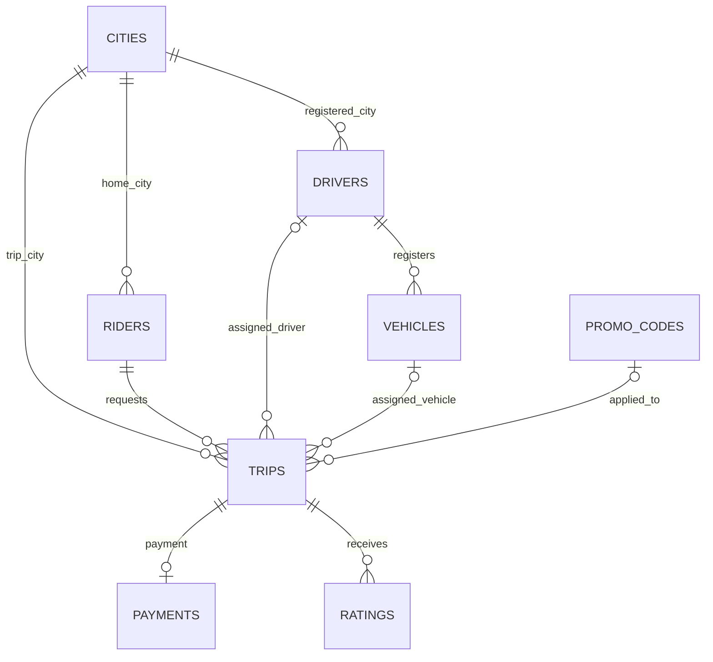

# CP-1 — Schema design and normalization

## 1. Design summary

The eight CSV files become eight tables in PostgreSQL schema `uber`. The table and column names match the CSV headers because `queries/workload_30.sql` depends on those names. The `trips` table is the transaction centre. Master data (cities, riders, drivers, vehicles and promo codes) is separated from trips, payments and ratings to reduce duplication.

**Load order:** `cities` → `riders` and `drivers` → `vehicles` and `promo_codes` → `trips` → `payments` and `ratings`.

## 2. Data dictionary

Types are chosen from the data meaning: IDs and counts are integers; phone numbers are strings; money and rates use exact `NUMERIC`; coordinates use six-decimal `NUMERIC`; CSV timestamps with `+05:30` use `TIMESTAMPTZ`; flags use `BOOLEAN`.

### `cities` — 10 rows

| Column | PostgreSQL type | Constraint | Why |
|---|---|---|---|
| city_id | INTEGER | PK, NOT NULL | Stable city identifier. |
| city_name | VARCHAR(40) | NOT NULL, UNIQUE | City name is a candidate key. |
| state | VARCHAR(50) | NOT NULL | State/UT name. |
| base_fare | NUMERIC(8,2) | NOT NULL, CHECK > 0 | Exact monetary value. |
| per_km_rate | NUMERIC(8,2) | NOT NULL, CHECK > 0 | Exact distance rate. |
| per_min_rate | NUMERIC(8,2) | NOT NULL, CHECK >= 0 | Exact time rate. |
| launched_on | DATE | NOT NULL | Calendar date, no time component. |

### `riders` — 30,000 rows

| Column | PostgreSQL type | Constraint | Why |
|---|---|---|---|
| rider_id | INTEGER | PK, NOT NULL | Rider identifier. |
| full_name | VARCHAR(100) | NOT NULL | Person's display name; not unique. |
| email | VARCHAR(254) | NOT NULL, UNIQUE | Candidate key; length follows email convention. |
| phone | VARCHAR(20) | NOT NULL, UNIQUE | Text preserves formatting/leading zeros. |
| home_city_id | INTEGER | NOT NULL, FK → cities.city_id | Rider's home city. |
| signup_date | DATE | NOT NULL | Signup calendar date. |
| rider_rating | NUMERIC(2,1) | NULL, CHECK 1.0–5.0 | 882 rows have no summary rating. |
| is_active | BOOLEAN | NOT NULL | Active/inactive flag (`t`/`f` in CSV). |

### `drivers` — 3,000 rows

| Column | PostgreSQL type | Constraint | Why |
|---|---|---|---|
| driver_id | INTEGER | PK, NOT NULL | Driver identifier. |
| full_name | VARCHAR(100) | NOT NULL | Name is not unique. |
| phone | VARCHAR(20) | NOT NULL, UNIQUE | Driver contact number. |
| license_no | VARCHAR(30) | NOT NULL, UNIQUE | Driving licence identifier. |
| city_id | INTEGER | NOT NULL, FK → cities.city_id | Driver's home/registered city. |
| joined_on | DATE | NOT NULL | Joining date. |
| driver_rating | NUMERIC(2,1) | NOT NULL, CHECK 1.0–5.0 | Supplied driver summary rating. |
| status | VARCHAR(15) | NOT NULL, CHECK ACTIVE/INACTIVE/SUSPENDED | Only the three exported statuses are permitted. |

### `vehicles` — 3,300 rows

| Column | PostgreSQL type | Constraint | Why |
|---|---|---|---|
| vehicle_id | INTEGER | PK, NOT NULL | Vehicle identifier. |
| driver_id | INTEGER | NOT NULL, FK → drivers.driver_id | Registered owner/driver. |
| registration_no | VARCHAR(20) | NOT NULL, UNIQUE | Vehicle registration is a candidate key. |
| make | VARCHAR(40) | NOT NULL | Manufacturer. |
| model | VARCHAR(40) | NOT NULL | Model name. |
| manufacture_year | SMALLINT | NOT NULL, CHECK 1900–2100 | Small whole-number year. |
| vehicle_type | VARCHAR(10) | NOT NULL, CHECK in MINI/SEDAN/SUV/AUTO/BIKE | Controlled category. |
| seat_capacity | SMALLINT | NOT NULL, CHECK > 0 and type/capacity pairing | Positive whole-number capacity. |

`UNIQUE(vehicle_id, driver_id)` is also declared so `trips` can use a composite foreign key to validate that the selected vehicle belongs to the selected driver. It is a constraint-created supporting index, not a query-tuning index.

### `promo_codes` — 40 rows

| Column | PostgreSQL type | Constraint | Why |
|---|---|---|---|
| promo_code | VARCHAR(20) | PK, NOT NULL | Code is the natural identifier. |
| discount_pct | NUMERIC(5,2) | NOT NULL, CHECK 1–100 | Percentage with exact numeric representation. |
| max_discount | NUMERIC(10,2) | NOT NULL, CHECK > 0 | Maximum monetary discount. |
| valid_from | DATE | NOT NULL | First valid date. |
| valid_to | DATE | NOT NULL, CHECK >= valid_from | Last valid date cannot precede start. |
| is_active | BOOLEAN | NOT NULL | Activation flag. |

### `trips` — 300,000 rows

| Column | PostgreSQL type | Constraint | Why |
|---|---|---|---|
| trip_id | INTEGER | PK, NOT NULL | Trip identifier. |
| rider_id | INTEGER | NOT NULL, FK → riders.rider_id | Every trip request belongs to a rider. |
| driver_id | INTEGER | NULL, FK → drivers.driver_id | Not yet assigned for some requests/cancellations. |
| vehicle_id | INTEGER | NULL, FK → vehicles.vehicle_id | Not yet assigned for some requests/cancellations. |
| city_id | INTEGER | NOT NULL, FK → cities.city_id | Operating city for the trip. |
| promo_code | VARCHAR(20) | NULL, FK → promo_codes.promo_code | Most trips use no promo code. |
| requested_at | TIMESTAMPTZ | NOT NULL | Export includes `+05:30` offset. |
| pickup_at | TIMESTAMPTZ | NULL | Not present before pickup or for cancelled trips. |
| dropoff_at | TIMESTAMPTZ | NULL | Present only after a completed trip. |
| pickup_lat | NUMERIC(9,6) | NOT NULL, CHECK -90 to 90 | Latitude coordinate. |
| pickup_lng | NUMERIC(9,6) | NOT NULL, CHECK -180 to 180 | Longitude coordinate. |
| drop_lat | NUMERIC(9,6) | NOT NULL, CHECK -90 to 90 | Latitude coordinate. |
| drop_lng | NUMERIC(9,6) | NOT NULL, CHECK -180 to 180 | Longitude coordinate. |
| distance_km | NUMERIC(7,2) | NULL, CHECK >= 0 | Not known until trip completes. |
| duration_min | SMALLINT | NULL, CHECK >= 0 | Whole-number trip duration. |
| surge_multiplier | NUMERIC(4,2) | NOT NULL, CHECK >= 1 | Exact multiplier. |
| fare_amount | NUMERIC(10,2) | NULL, CHECK >= 0 | Final fare is absent for unfinished/cancelled trips. |
| status | VARCHAR(25) | NOT NULL, CHECK allowed values | Trip lifecycle state. |

Additional trip checks: driver and vehicle are either both NULL or both present; the vehicle/driver pair must exist in `vehicles`; pickup cannot precede request; drop-off requires pickup and cannot precede it; status-specific field checks are included in `01_schema.sql`.

### `payments` — 245,839 rows

| Column | PostgreSQL type | Constraint | Why |
|---|---|---|---|
| payment_id | INTEGER | PK, NOT NULL | Payment record identifier. |
| trip_id | INTEGER | NOT NULL, UNIQUE, FK → trips.trip_id | At most one payment record per trip in this export. |
| amount | NUMERIC(10,2) | NOT NULL, CHECK >= 0 | Exact monetary amount. |
| method | VARCHAR(10) | NOT NULL, CHECK UPI/CASH/CARD/WALLET | Controlled payment method. |
| payment_status | VARCHAR(10) | NOT NULL, CHECK SUCCESS/FAILED/REFUNDED | Payment outcome. |
| paid_at | TIMESTAMPTZ | NOT NULL | Payment timestamp includes timezone offset. |

### `ratings` — 307,214 rows

| Column | PostgreSQL type | Constraint | Why |
|---|---|---|---|
| trip_id | INTEGER | PK part, FK → trips.trip_id, NOT NULL | Trip being rated. |
| rated_by | VARCHAR(10) | PK part, CHECK RIDER/DRIVER, NOT NULL | Identifies which side submitted the rating. |
| stars | SMALLINT | NOT NULL, CHECK 1–5 | Whole-number star rating. |
| comment | TEXT | NULL | 245,486 comments are empty in the export. |
| created_at | TIMESTAMPTZ | NOT NULL | Rating creation time. |

The primary key is `(trip_id, rated_by)`, not just `trip_id`: one trip may have one rider rating and one driver rating.

## 3. Relationships and cardinality

| Parent → child | Cardinality | Explanation |
|---|---|---|
| cities → riders | 1 : many | Each rider has one home city; a city has many riders. |
| cities → drivers | 1 : many | Each driver has one registered city. |
| drivers → vehicles | 1 : many | A driver can register multiple vehicles (3,300 vehicles for 3,000 drivers). |
| riders → trips | 1 : many | A rider can request many trips. |
| drivers → trips | 1 : many, optional on trip | Some requests have no assigned driver yet. |
| vehicles → trips | 1 : many, optional on trip | Some requests have no assigned vehicle yet. |
| cities → trips | 1 : many | Every trip belongs to an operating city. |
| promo_codes → trips | 1 : many, optional on trip | A trip may use no promo code. |
| trips → payments | 1 : 0-or-1 | `payments.trip_id` is UNIQUE; all completed seed trips currently have one. |
| trips → ratings | 1 : 0-to-2 | Composite key permits at most one rating per side. |

Riders and drivers therefore have a many-to-many relationship over time through `trips`.

## 4. Mermaid ER diagram source

The PNG export is `diagrams/er_diagram.png`. Editable Mermaid source is also saved as `diagrams/er_diagram.mmd`.



## 5. Functional dependencies and normal forms

Functional dependency (FD) means the left-hand attribute(s) determine the right-hand attributes. For each table, the main FD is:

| Table | Functional dependency (key → non-key attributes) | Candidate key(s) |
|---|---|---|
| cities | `city_id → city_name, state, base_fare, per_km_rate, per_min_rate, launched_on` | `city_id`, `city_name` |
| riders | `rider_id → full_name, email, phone, home_city_id, signup_date, rider_rating, is_active` | `rider_id`, `email`, `phone` |
| drivers | `driver_id → full_name, phone, license_no, city_id, joined_on, driver_rating, status` | `driver_id`, `phone`, `license_no` |
| vehicles | `vehicle_id → driver_id, registration_no, make, model, manufacture_year, vehicle_type, seat_capacity` | `vehicle_id`, `registration_no` |
| promo_codes | `promo_code → discount_pct, max_discount, valid_from, valid_to, is_active` | `promo_code` |
| trips | `trip_id → rider_id, driver_id, vehicle_id, city_id, promo_code, requested_at, pickup_at, dropoff_at, coordinates, distance_km, duration_min, surge_multiplier, fare_amount, status` | `trip_id` |
| payments | `payment_id → trip_id, amount, method, payment_status, paid_at`; also `trip_id → payment_id, amount, method, payment_status, paid_at` due UNIQUE | `payment_id`, `trip_id` |
| ratings | `(trip_id, rated_by) → stars, comment, created_at` | `(trip_id, rated_by)` |

**1NF:** Every CSV column is a single value (atomic); no multi-valued list is stored in a cell. Ratings are separate rows by `rated_by` rather than two rating columns on a trip.

**2NF:** Tables with a single-column key have no partial-key dependency. In `ratings`, all non-key attributes depend on the full composite key `(trip_id, rated_by)`, not on either part alone.

**3NF:** Non-key attributes describe their table's key. City descriptions/rates live in `cities`, rider details in `riders`, driver details in `drivers`, vehicle details in `vehicles`, and payment/rating facts in their own tables. This avoids transitive dependencies such as storing `city_name` in every rider and trip row.

**BCNF:** Under the stated candidate keys, every listed determinant is a candidate key (or a superkey such as the declared `(vehicle_id, driver_id)` uniqueness), so the decomposed tables satisfy BCNF for these dependencies.

### Intentional derived/redundant values

- `rider_rating` and `driver_rating` are summary values while `ratings` stores individual events. Keeping a cached summary can make profile/driver queries faster, but it must be refreshed consistently. Treat `ratings` as the detailed history and the summary field as a denormalized snapshot.
- `trips.fare_amount` is not recomputed from the current `cities` rates. It preserves the fare charged at the time of the trip (including surge, promo and historical pricing rules).
- `payments.amount` often equals the trip fare in the seed data, but is retained as the payment-side amount because payment records describe what was attempted/settled/refunded.

## 6. NULL analysis and lifecycle rules

The CSV export has empty fields that should load as SQL NULL, not as invented zero values. Important examples from the data:

| Column(s) | Missing rows | Interpretation |
|---|---:|---|
| `riders.rider_rating` | 882 | No summary rating available. |
| `trips.driver_id`, `trips.vehicle_id` | 15,098 each | Unassigned `REQUESTED` trips and some rider-cancelled trips. They are NULL together. |
| `trips.pickup_at` | 54,061 | No pickup occurred for accepted/requested/cancelled rows. |
| `trips.dropoff_at`, `distance_km`, `duration_min`, `fare_amount` | 54,161 each | Trip has not completed or was cancelled. |
| `trips.promo_code` | 280,027 | No promo code applied. |
| `ratings.comment` | 245,486 | Comment is optional; numeric rating still exists. |

All four trip coordinate columns are populated for every exported trip. `payments.paid_at` and `ratings.created_at` are populated for all rows.

Trip status counts in the seed export:

| Status | Rows | Design implication |
|---|---:|---|
| COMPLETED | 245,839 | Driver/vehicle, pickup/dropoff, distance, duration and fare are present. |
| CANCELLED_BY_RIDER | 29,897 | No pickup/dropoff/fare; driver/vehicle may both be absent or both assigned. |
| CANCELLED_BY_DRIVER | 23,964 | Driver/vehicle assigned; no pickup/dropoff/fare. |
| ACCEPTED | 100 | Driver/vehicle assigned; pickup has not happened. |
| ONGOING | 100 | Driver/vehicle and pickup exist; dropoff/fare not yet present. |
| REQUESTED | 100 | No driver or vehicle assigned yet. |

## 7. Constraints implemented

`01_schema.sql` includes more than 12 meaningful constraints: primary keys; unique city name, email, rider/driver phones, licence numbers and vehicle registrations; foreign keys; rating and money ranges; coordinate bounds; controlled status/method/type values; promo validity dates; vehicle-type/seat-capacity combinations; paired driver/vehicle nullability and ownership; timestamp ordering; and trip-status-dependent required/absent fields.

Only constraint-generated indexes exist at this phase (PRIMARY KEY and UNIQUE support). There are no manual `CREATE INDEX` statements; performance indexes are reserved for Phase 4/CP-3.

All foreign keys use `ON DELETE RESTRICT` to protect referenced historical/master records. Trip records should not silently disappear because a parent is deleted. `payments.trip_id` is UNIQUE to enforce at most one payment per trip.

## 8. Pre-load data audit (from the supplied CSVs)

These are checks performed on the supplied CSV contents before PostgreSQL loading. After running `02_load_data.sql`, rerun the SQL checks below and record the actual PostgreSQL output. Do not report the CSV audit as a PostgreSQL execution result.

| Check | Result from supplied CSV data |
|---|---:|
| Row counts | 10 cities; 30,000 riders; 3,000 drivers; 3,300 vehicles; 40 promo codes; 300,000 trips; 245,839 payments; 307,214 ratings |
| Orphan references across all listed FK relationships | 0 |
| Trips with assigned vehicle that belongs to a different driver | 0 (284,902 trips have both driver and vehicle assigned) |
| Completed trips missing a payment | 0 (245,839 completed trips, 245,839 payment rows) |
| Payments attached to non-completed trips | 0 |
| Duplicate `(trip_id, rated_by)` rating keys | 0 |
| Ratings attached to non-completed trips | 0 |
| Time-order violations (`pickup_at < requested_at` or `dropoff_at < pickup_at`) | 0 |
| Duplicate email values after lowercasing | 0 in this export |

### SQL checks to run after loading

```sql
-- 1. Row counts
SELECT 'cities' AS table_name, count(*) FROM uber.cities
UNION ALL SELECT 'riders', count(*) FROM uber.riders
UNION ALL SELECT 'drivers', count(*) FROM uber.drivers
UNION ALL SELECT 'vehicles', count(*) FROM uber.vehicles
UNION ALL SELECT 'promo_codes', count(*) FROM uber.promo_codes
UNION ALL SELECT 'trips', count(*) FROM uber.trips
UNION ALL SELECT 'payments', count(*) FROM uber.payments
UNION ALL SELECT 'ratings', count(*) FROM uber.ratings
ORDER BY table_name;

-- 2. Every completed trip should have one payment; expected result: 0
SELECT count(*) AS completed_without_one_payment
FROM uber.trips t
LEFT JOIN uber.payments p ON p.trip_id = t.trip_id
WHERE t.status = 'COMPLETED' AND p.payment_id IS NULL;

-- 3. A trip's vehicle must belong to its assigned driver; expected result: 0
SELECT count(*) AS vehicle_driver_mismatches
FROM uber.trips t
JOIN uber.vehicles v ON v.vehicle_id = t.vehicle_id
WHERE t.driver_id IS DISTINCT FROM v.driver_id;

-- 4. Ratings should refer to completed trips; expected result: 0
SELECT count(*) AS ratings_on_noncompleted_trips
FROM uber.ratings r
JOIN uber.trips t ON t.trip_id = r.trip_id
WHERE t.status <> 'COMPLETED';
```

## 9. How to run

Run commands from the project root (the folder containing `seed_data/`, `sql/`, `queries/`):

```bash
createdb uber_db
psql -d uber_db -f sql/01_schema.sql
psql -d uber_db -f sql/02_load_data.sql
```

The benchmark helper sets `search_path TO uber` for each query, so its unqualified table names resolve correctly. `seed_data/` is local input only and must not be committed; `.gitignore` already excludes it.
